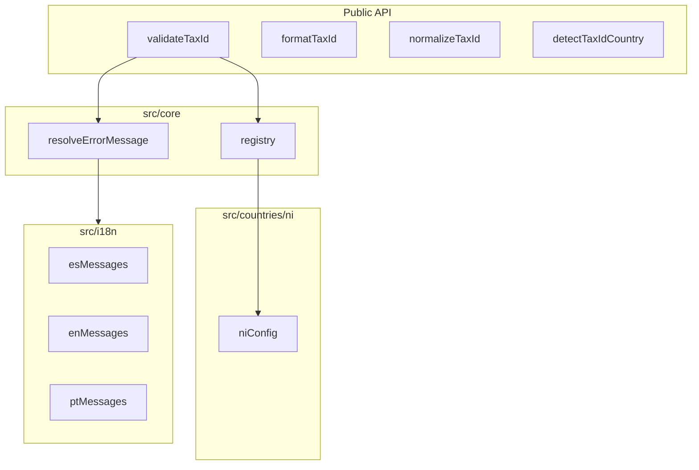

# Arev Tax ID Validator

Biblioteca TypeScript para validar identificadores fiscales en Latinoamérica. Unifica validación, normalización, formato visual y mensajes de error en un solo API, con adapters para Zod, React, React Hook Form y NestJS.

## Qué hace el package

`@arev/tax-id-validator` resuelve un problema común en formularios y APIs: **cada país tiene su propio documento fiscal** (RUC, RFC, CUIT, etc.) con reglas distintas de longitud, caracteres permitidos y formato de visualización.

Este package te permite:

| Capacidad | Qué hace | Ejemplo |
|-----------|----------|---------|
| **Validar** | Comprueba si un valor cumple las reglas del país | ¿`001-230480-0004A` es un RUC válido de Nicaragua? |
| **Normalizar** | Limpia el input para guardarlo en BD o enviarlo a APIs | `001-230480-0004A` → `0012304800004A` |
| **Formatear** | Aplica la máscara visual del país | `0012304800004A` → `001-230480-0004A` |
| **Detectar país** | Infiere el país por la forma del valor | 14 caracteres alfanuméricos → probablemente `NI` |
| **Errores tipados** | Devuelve códigos estables (`INVALID_LENGTH`, etc.), no strings sueltos | Ideal para i18n y lógica condicional |
| **i18n** | Traduce mensajes de error a `es`, `en` o `pt` | `Longitud inválida` / `Invalid length` |

### Flujo típico

```
Input del usuario     →  normalize  →  validate  →  guardar / rechazar
"001-230480-0004A"       "0012304800004A"   ✓ valid
"123"                    "123"              ✗ INVALID_LENGTH
```

1. El usuario escribe en un input (con o sin guiones).
2. **`normalizeTaxId`** deja el valor listo para persistencia.
3. **`validateTaxId`** aplica las reglas del país y devuelve errores traducidos.
4. **`formatTaxId`** muestra el valor con la máscara correcta en la UI.

### Países soportados hoy

Solo **Nicaragua (`NI`)** — RUC de 14 caracteres alfanuméricos.

La arquitectura está preparada para agregar más países: cada uno define su propio `config` (validar, formatear, detectar, metadata, máscara) y se registra en un `registry` central.

### Qué **no** hace (aún)

- No valida checksum/dígito verificador real del RUC nicaragüense.
- No consulta APIs gubernamentales.
- No valida de forma asíncrona.

### Paquetes del monorepo

El **core** es agnóstico de framework. Los demás packages son adapters finos sobre el mismo `validateTaxId`:

| Package | Para qué sirve |
|---------|----------------|
| `@arev/tax-id-validator` | API principal (Node, browser, edge) |
| `@arev/tax-id-validator-zod` | Schemas Zod en backend o frontend |
| `@arev/tax-id-validator-react` | Hook `useTaxId` con validación reactiva |
| `@arev/tax-id-validator-react-hook-form` | Regla `validate` para React Hook Form |
| `@arev/tax-id-validator-nestjs` | Pipe que normaliza o lanza `400 Bad Request` |

### Casos de uso

- **Formulario de registro** — validar RUC en tiempo real mientras el usuario escribe.
- **API REST (NestJS)** — rechazar requests con documento inválido antes de llegar al servicio.
- **Validación de DTOs (Zod)** — mismo criterio en frontend y backend.
- **Normalización en BD** — siempre persistir el valor sin guiones y en mayúsculas.

Demo interactivo: [`examples/demo`](./examples/demo) — `pnpm example:dev`.

---

## Packages

| Package | Description |
|---------|-------------|
| [`@arev/tax-id-validator`](./) | Core validation API |
| [`@arev/tax-id-validator-zod`](./packages/zod) | Zod schema helper |
| [`@arev/tax-id-validator-react`](./packages/react) | React hook |
| [`@arev/tax-id-validator-react-hook-form`](./packages/react-hook-form) | React Hook Form validator |
| [`@arev/tax-id-validator-nestjs`](./packages/nestjs) | NestJS pipe |

## Supported countries

| Code | Tax ID | Status |
|------|--------|--------|
| `NI` | RUC (Registro Único de Contribuyente) | Format + length validation |

## Installation

```bash
pnpm add @arev/tax-id-validator
```

Integration packages are installed separately:

```bash
pnpm add @arev/tax-id-validator-zod zod
pnpm add @arev/tax-id-validator-react react
pnpm add @arev/tax-id-validator-react-hook-form
pnpm add @arev/tax-id-validator-nestjs @nestjs/common
```

## Quick start

```ts
import { validateTaxId } from '@arev/tax-id-validator'

const result = validateTaxId(
  { country: 'NI', value: '001-230480-0004A' },
  { locale: 'es' }
)

console.log(result.valid)       // true
console.log(result.normalized)  // "0012304800004A"
console.log(result.formatted)   // "001-230480-0004A"
console.log(result.errors)      // []
```

## Core API

### `validateTaxId(params, options?)`

Validates a tax ID for a given country.

```ts
validateTaxId(
  { country: 'NI', value: string },
  { locale?: 'es' | 'en' | 'pt' }  // default: 'es'
)
```

Returns:

```ts
interface TaxIdValidationResult {
  valid: boolean
  normalized: string
  formatted?: string
  country?: string
  errors: TaxIdValidationError[]
}
```

### `formatTaxId(params)`

Formats a value using the country-specific mask.

```ts
formatTaxId({ country: 'NI', value: '0012304800004A' })
// "001-230480-0004A"
```

### `normalizeTaxId(params)`

Strips separators and uppercases the value.

```ts
normalizeTaxId({ country: 'NI', value: '001-230480-0004A' })
// "0012304800004A"
```

### `detectTaxIdCountry(value)`

Attempts to detect the country from the input shape.

```ts
detectTaxIdCountry('001-230480-0004A')
// { country: 'NI', confidence: 0.9 }
```

## Typed errors

Errors use stable codes instead of plain strings:

```ts
enum TaxIdErrorCode {
  REQUIRED = 'REQUIRED',
  INVALID_LENGTH = 'INVALID_LENGTH',
  INVALID_CHARACTERS = 'INVALID_CHARACTERS',
  INVALID_FORMAT = 'INVALID_FORMAT',
  INVALID_CHECKSUM = 'INVALID_CHECKSUM',
  INVALID_COUNTRY = 'INVALID_COUNTRY'
}
```

`validateTaxId` resolves human-readable messages based on `locale`:

| Locale | Example (`INVALID_LENGTH`) |
|--------|----------------------------|
| `es` | Longitud inválida |
| `en` | Invalid length |
| `pt` | Comprimento inválido |

## Nicaragua (NI) — RUC

| Property | Value |
|----------|-------|
| Label | RUC |
| Placeholder | `001-230480-0004A` |
| Normalized length | 14 alphanumeric characters |
| Display format | `000-000000-0000A` |
| Input mask | `000-000000-0000A` |

Checksum validation is not implemented yet.

## Integration packages

### Zod

```ts
import { z } from 'zod'
import { taxIdSchema } from '@arev/tax-id-validator-zod'

const schema = z.object({
  ruc: taxIdSchema('NI')
})
```

### React

```tsx
import { useTaxId } from '@arev/tax-id-validator-react'

function RucField({ value }: { value: string }) {
  const { valid, normalized, formattedValue, errors } = useTaxId('NI', value)

  return (
    <div>
      <p>{formattedValue}</p>
      {!valid && <p>{errors[0]?.message}</p>}
    </div>
  )
}
```

### React Hook Form

```tsx
import { useForm } from 'react-hook-form'
import { validateTaxIdField } from '@arev/tax-id-validator-react-hook-form'

const { register } = useForm()

<input {...register('ruc', { validate: validateTaxIdField('NI') })} />
```

### NestJS

```ts
import { Body, Controller, Post } from '@nestjs/common'
import { TaxIdPipe } from '@arev/tax-id-validator-nestjs'

@Controller('taxpayers')
export class TaxpayersController {
  @Post()
  create(@Body('ruc', new TaxIdPipe('NI')) ruc: string) {
    // ruc is normalized: "0012304800004A"
    return { ruc }
  }
}
```

On validation failure, `TaxIdPipe` throws `BadRequestException` with `{ errors: TaxIdValidationError[] }`.

## Project structure

```
arev-tax-id-validator/
├── src/
│   ├── core/           # Public API orchestration
│   ├── countries/ni/   # Nicaragua RUC implementation
│   ├── i18n/           # Error message catalogs
│   ├── shared/         # Checksum utilities (scaffold)
│   └── types/          # Shared TypeScript types
├── packages/
│   ├── zod/
│   ├── react/
│   ├── react-hook-form/
│   └── nestjs/
├── examples/demo/      # Interactive demo app
└── tests/              # Core library tests
```

## Development

Requires [pnpm](https://pnpm.io/) 9+.

```bash
pnpm install
pnpm build
pnpm test
pnpm typecheck
pnpm lint
```

### Interactive demo

```bash
pnpm example:dev
```

Open [http://localhost:5173](http://localhost:5173). See [`examples/demo/README.md`](./examples/demo/README.md).

### Watch mode (core tests)

```bash
pnpm dev
```

## Architecture



Each country implements a `TaxIdConfig` with `normalize`, `format`, `detect`, `validate`, `metadata`, and optional `mask`. The registry maps country codes to configs.

## Roadmap

Planned for future releases:

- Real checksum algorithms per country
- Smarter multi-country detection
- Async / government API validation
- TanStack Form adapter
- JSON Schema / OpenAPI support
- CLI and playground docs

## License

UNLICENSED — private Arev project.
