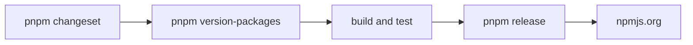

# Publishing to npm

Guide for publishing the `@arev/*` packages to the public npm registry.

## Packages

| Package | npm name |
|---------|----------|
| Core | `@arev/tax-id-validator` |
| Zod | `@arev/tax-id-validator-zod` |
| React | `@arev/tax-id-validator-react` |
| React Hook Form | `@arev/tax-id-validator-react-hook-form` |
| NestJS | `@arev/tax-id-validator-nestjs` |

The demo app (`examples/demo`) is **private** and is never published.

All five publishable packages share the same version (fixed versioning via Changesets).

---

## One-time setup

### 1. npm account and org

1. Create an account at [npmjs.com](https://www.npmjs.com/signup).
2. Enable **two-factor authentication (2FA)** — required to publish scoped packages.
3. Create an npm organization named **`arev`** (or get publish access to an existing `@arev` org).
4. Ensure your user has **publish** permission on the org.

### 2. Local login

```bash
npm login
npm whoami
```

Confirm you can publish under `@arev`:

```bash
npm org ls arev
```

### 3. Repository configuration

The monorepo already includes:

- [`.npmrc`](../.npmrc) — `access=public` for scoped packages
- `publishConfig.access: "public"` in each publishable `package.json`
- [Changesets](../.changeset/config.json) for version management

**Never commit npm tokens** to `.npmrc`. Use `npm login` locally; do not add `_authToken` to the tracked file.

---

## First publish (`0.1.0`)

```bash
pnpm install
pnpm build
pnpm test
npm login
pnpm release
```

`pnpm release` runs build, tests, then `changeset publish`.

### Fallback (without Changesets history)

If `changeset publish` fails because no changesets exist yet:

```bash
pnpm build
pnpm test
pnpm publish -r --access public --filter '@arev/*' --filter '!@arev/tax-id-validator-example'
```

Publish order is handled by pnpm: core first, then adapters.

---

## Subsequent releases

### 1. Record changes

```bash
pnpm changeset
```

- Select affected packages (usually all five in the fixed group).
- Choose bump type: `patch`, `minor`, or `major`.
- Write a short summary (becomes the changelog).

Commit the generated file under `.changeset/`.

### 2. Apply versions

```bash
pnpm version-packages
```

This bumps versions in all `package.json` files and updates changelogs.

### 3. Commit and merge

```bash
git add .
git commit -m "chore: version packages"
```

Open a PR or merge to `main` following your GitFlow process.

### 4. Publish

```bash
npm login
pnpm release
```

---

## Pre-publish checklist

Before every release:

- [ ] `pnpm build` — `dist/` exists in all five packages
- [ ] `pnpm test` — full suite passes
- [ ] `pnpm typecheck` — no TypeScript errors
- [ ] Versions are aligned (fixed group in Changesets)
- [ ] Changelog updated by `pnpm version-packages`
- [ ] `npm whoami` — active session with access to `@arev`
- [ ] `examples/demo` remains `"private": true`

---

## How versioning works



- **Fixed group**: all five packages get the same version (e.g. `0.2.0`).
- **`workspace:*`**: rewritten to semver ranges on publish (e.g. `^0.2.0`).
- **Publish order**: Changesets + pnpm publish core before adapters.

---

## Installing published packages

Consumers install the core and any adapters separately:

```bash
pnpm add @arev/tax-id-validator
pnpm add @arev/tax-id-validator-zod zod
pnpm add @arev/tax-id-validator-react react
pnpm add @arev/tax-id-validator-react-hook-form
pnpm add @arev/tax-id-validator-nestjs @nestjs/common
```

Adapters declare `@arev/tax-id-validator` as a **peer dependency** — it must be installed alongside them.

---

## Troubleshooting

| Error | Cause | Fix |
|-------|-------|-----|
| `402 Payment Required` | Scoped package treated as private | Ensure `publishConfig.access: "public"` and `.npmrc` has `access=public` |
| `403 Forbidden` | No org permission or 2FA disabled | Join `@arev` org with publish role; enable 2FA on npm |
| `E404` on install | Package not published or wrong name | Verify package exists at `npmjs.com/package/@arev/tax-id-validator` |
| `workspace:*` on npm | Published raw `package.json` | Always use `changeset publish` or `pnpm publish`, never manual tarball with workspace refs |
| Version mismatch | Skipped `version-packages` | Run `pnpm version-packages` before publish |

---

## Scripts reference

| Script | Command | Purpose |
|--------|---------|---------|
| `pnpm changeset` | `changeset` | Create a new changeset file |
| `pnpm version-packages` | `changeset version` | Bump versions and changelogs |
| `pnpm release` | `build` + `test` + `changeset publish` | Full release pipeline |

---

## License

Published packages are licensed under **MIT**. See [LICENSE](../LICENSE).
